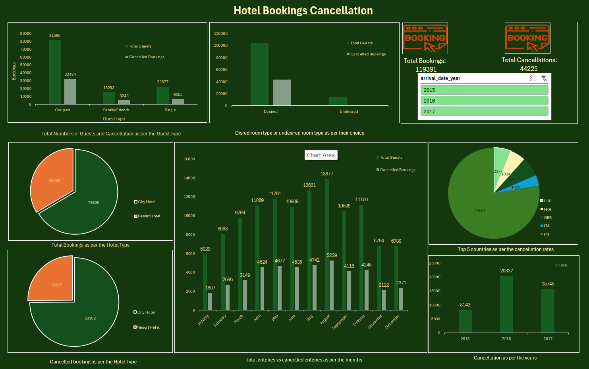

<div align="center">

# 🏨 Hotel Booking Cancellation Dashboard

**Explore booking patterns. Understand cancellations. Make smarter hospitality decisions.**

An Excel dashboard for exploring hotel reservations, guest segments, seasonal booking trends, and cancellation patterns.


</div>

---

## 📌 Overview

The **Hotel Booking Cancellation Dashboard** turns reservation data into a visual summary of booking behavior and cancellations. It is designed to help explore questions such as:

- How do cancellations vary by guest type?
- Which arrival months have higher cancellation counts?
- How do booking characteristics relate to cancellation behavior?
- What patterns appear across hotel types, customer segments, and room assignments?

The workbook includes the source booking data, a pivot-analysis sheet, and a dashboard sheet.

## ✨ Highlights

- **Cancellation analysis** — compare cancelled bookings with overall booking patterns.
- **Guest segmentation** — explore categories such as couples, families/friends, and other guest groups in the workbook.
- **Seasonality exploration** — compare booking and cancellation patterns by arrival month.
- **Reservation attributes** — inspect hotel type, customer type, deposit type, room type, booking changes, and special requests.
- **Excel workflow** — view source records, pivot summaries, and dashboard visuals in one workbook.

## 📊 Workbook at a glance

| Sheet | Purpose |
|---|---|
| `hotel_bookings` | Reservation-level dataset and supporting fields |
| `Pivot` | Pivot-table summaries used for analysis |
| `Dashboard` | Visual dashboard for exploring results |

### Data fields

The source sheet includes fields such as:

- **Booking outcome:** `is_canceled`, `reservation_status`, `reservation_status_date`
- **Arrival details:** `arrival_date_year`, `arrival_date_month`
- **Guest details:** `adults`, `children`, `babies`, `country`, `customer_type`
- **Reservation details:** `hotel`, `reserved_room_type`, `assigned_room_type`, `deposit_type`
- **Booking behavior:** `booking_changes`, `days_in_waiting_list`, `total_of_special_requests`
- **Commercial / operational fields:** `adr`, `agent`, `company`, `required_car_parking_spaces`

> The workbook also includes derived fields such as `room_status` and `Guest_type`. Check their definitions before interpreting them in a business context.

## 🧭 How to use

1. Download or clone this repository.
2. Open `Hotel Booking Cancellation Dashboard.xlsx` in Microsoft Excel.
3. Go to the **Dashboard** sheet.
4. Use any available chart filters or slicers to explore segments.
5. Refer to the **Pivot** sheet to inspect the summary tables behind the visuals.
6. Review `hotel_bookings` when you need to verify underlying records.

**Tip:** If slicers or pivot summaries do not update as expected, open the file in desktop Excel and select **Data → Refresh All**.

## 🛠️ Tools & techniques

- Microsoft Excel
- Pivot tables and summarized metrics
- Charts and dashboard design
- Exploratory data analysis
- Hospitality booking and cancellation analysis

## 📂 Suggested repository structure

```text
hotel-booking-cancellation-dashboard/
├── README.md
├── Hotel Booking Cancellation Dashboard.xlsx
├── screenshots/
│   └── dashboard-preview.png
└── LICENSE
```

- Add a clear screenshot of the dashboard at `screenshots/dashboard-preview.png`.
- Include a `LICENSE` only if you want to publish the project under a specific license.
- Keep future cleaned data, notes, and documentation in clearly named folders.

## 🖼️ Dashboard preview



## 🔎 Analysis ideas

Possible extensions include:

- **Cancellation rate** = cancelled bookings ÷ total bookings
- Cancellation rate by hotel type, month, customer type, and deposit type
- Average daily rate (`adr`) comparison for cancelled vs. non-cancelled bookings
- Lead-time and waiting-list analysis, if those fields are available
- Special-request and booking-change patterns by cancellation status

Keep the numerator and denominator consistent when calculating metrics, and define clearly what counts as a booking.

## ⚠️ Data notes

- Treat `is_canceled = 1` as cancelled and `is_canceled = 0` as not cancelled, subject to the dataset documentation.
- Some fields may contain missing values represented as `NULL`; handle these consistently before calculating metrics.
- `reservation_status` and `is_canceled` are related but should not automatically be treated as interchangeable.
- The dashboard is descriptive analysis; it does not by itself establish causation.

## 🚀 Future improvements

- Add KPI cards for total bookings, cancellations, and cancellation rate.
- Use consistent colors for cancelled and non-cancelled bookings.
- Add slicers for hotel type, arrival year, and customer type.
- Add a **Key Findings** section with verified numbers from the dashboard.
- Include a clean dashboard screenshot and a short walkthrough GIF.
- Document the dataset source and any data-cleaning steps.

## 👤 Author

**Mayank Pandey**

If you find this project useful, consider giving the repository a ⭐.

---

<div align="center">

*Turning reservation data into clearer insights.*

</div>
